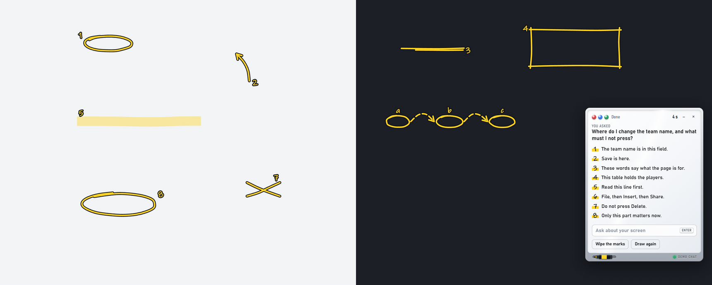

# Screen Coach

A small whiteboard on your Windows screen for Claude Code. Type a question about what you see. The Claude Code chat you are already in takes one screenshot, answers on the board in short numbered lines, and points at the right spots with hand-drawn marker marks.

No second AI and no API key: the answer comes from the chat you started it in, with everything that chat already knows about your work.



## Install

In Claude Code, run:

```
/plugin marketplace add RanaTriesAI/screen-coach
/plugin install screen-coach@ranatriesai
```

Then open a new chat, or run `/reload-plugins`.

## Use

1. Say **coach on** in any chat. The first start installs the board app and takes a few minutes. After that, the board shows the chat's name with a green light.
2. Type a question on the board and press Enter. For example:
   - "Where do I change my profile picture on this page?"
   - "Which of these settings turns off the notifications?"
   - "What does this error mean, and what do I click next?"
3. The answer shows on the board and in the chat. A marker pen draws the marks: ring, arrow, underline, box, highlight, steps, cross and spotlight.
4. Close the board with **×**, or say **coach off**.

Most answers take 15 to 40 seconds. The chat must be idle: a chat that is busy with a long job answers after that job.

## Requirements

- Windows 10 or 11. macOS is not supported yet.
- Claude Code (terminal, IDE extension or desktop app).
- Node.js (the LTS version), used once to install the board app.

## What it runs, stores and sends

- **Runs:** two PowerShell scripts (`bridge/`) and the board, a see-through Electron window (`app/`). Nothing starts with Windows. The board runs only after you say "coach on".
- **Downloads, once:** on the first start, `npm ci` installs Electron 44.7.2 (pinned in `app/package-lock.json`) from the npm registry. Then Electron's own installer downloads the Electron program from GitHub and checks it against the checksums in the package. All of it goes into the plugin's data folder: about 380 MB.
- **Screenshots:** one screenshot of your main screen, only when you send a question. It is saved in the plugin's data folder (`~/.claude/plugins/data/screen-coach-ranatriesai/shots/`). While the board is open, it keeps the screenshots of the 3 newest questions. When it closes, it moves all of them to the Recycle Bin.
- **Sends:** nothing by itself. Your Claude Code chat reads the screenshot like any picture you paste into Claude, so the picture becomes part of your conversation with Claude.
- No analytics, no tracking, no other network calls.

Details: [PRIVACY.md](PRIVACY.md).

## How it works

The board works like a mail slot. When you send a question, it saves the text and one screenshot to a folder. Your chat waits on that folder with a background command. When the question arrives, the command ends, and that wakes the chat. The chat looks at the screenshot and writes its answer to a file. The board reads the file and draws the marks.

## Limits

- It sees and points on the main screen only.
- It points. It never clicks or types for you.
- One chat holds the coach at a time. Say "coach on" in another chat and the coach moves there.
- It has been tested on one Windows 11 PC so far. On other screen setups the marks may land a little off. Please tell us in an issue.

## Uninstall

```
/plugin uninstall screen-coach@ranatriesai
```

Claude Code removes the plugin's data folder too: the board app and any leftover files.

## Support

Questions and bugs: [open an issue](https://github.com/RanaTriesAI/screen-coach/issues). Security problems: see [SECURITY.md](SECURITY.md).

## License

MIT. See [LICENSE](LICENSE). Made by Rana Tries AI.
